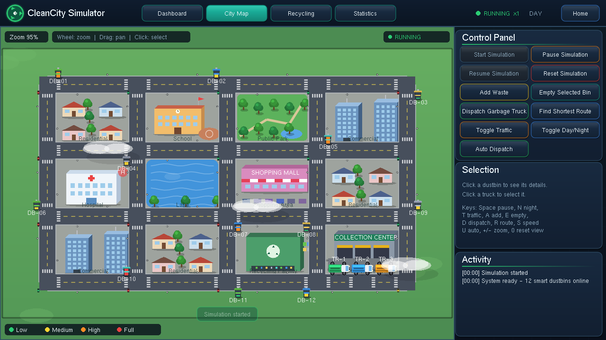
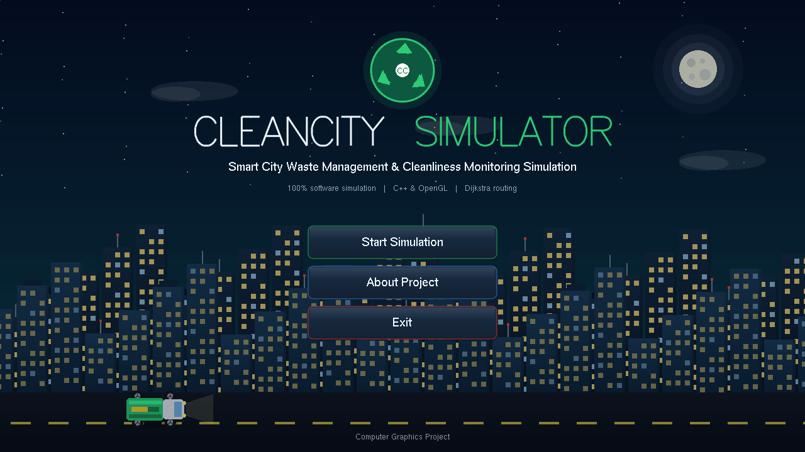
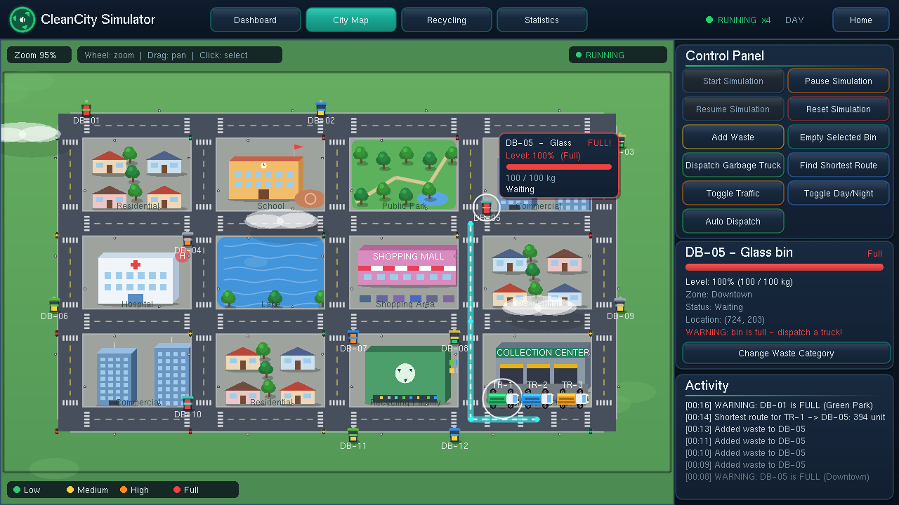
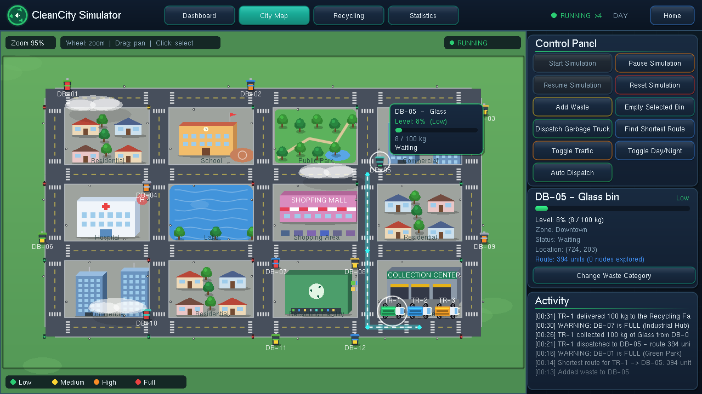
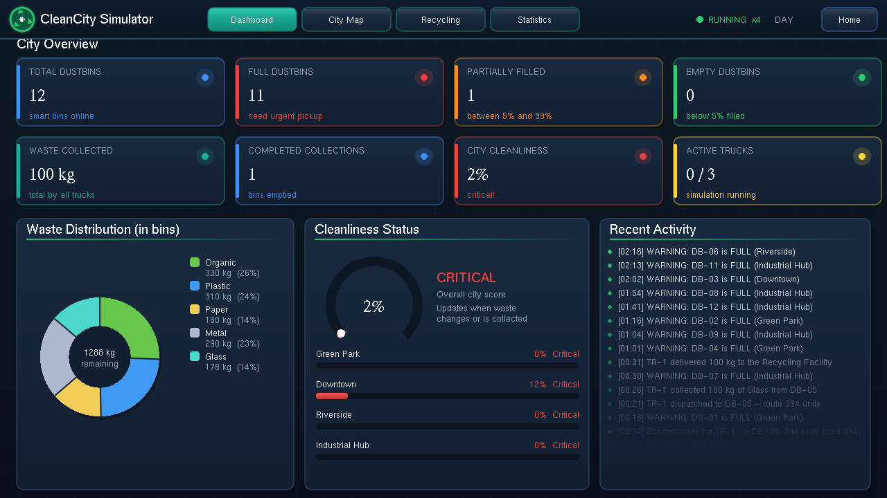
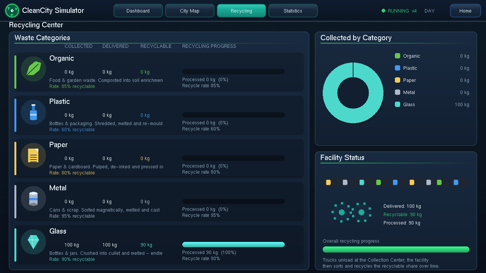
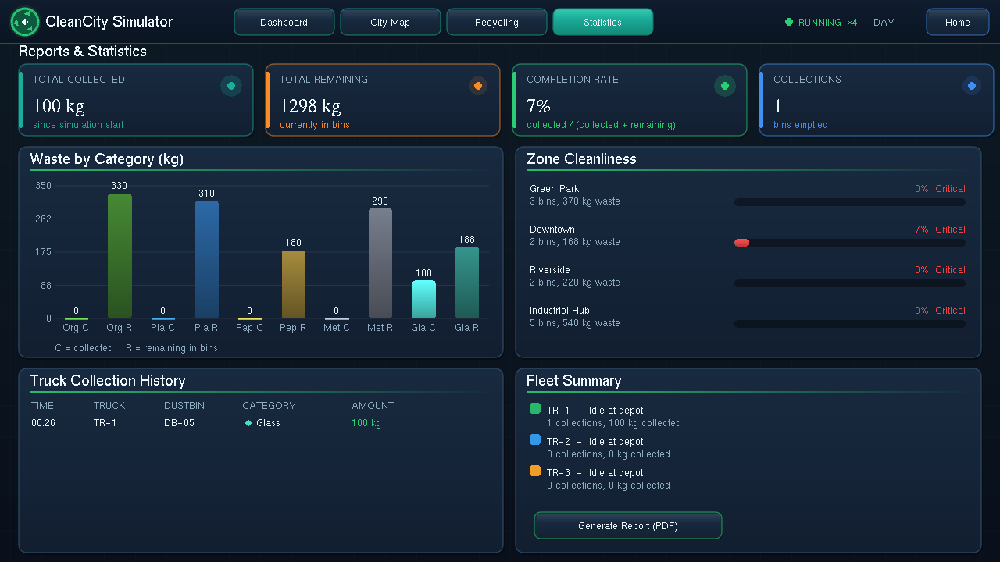

<div align="center">

# 🏙️ CleanCitySimulator

### Smart City Waste Management Simulator

*A fully software-based 2D simulation built with **C++**, **OpenGL** and **FreeGLUT** to demonstrate Computer Graphics concepts through a real-world problem.*


<br>



</div>

---

## 📖 Overview

**CleanCitySimulator** simulates how a smart city collects and recycles its waste, entirely in software. There is no hardware, no sensors, no GPS and no real-world data. Dustbins fill up over time, garbage trucks are dispatched along **Dijkstra-optimised routes**, waste is delivered to a recycling center, and a live dashboard tracks everything.

The project is designed as an academic Computer Graphics showcase: the map, trucks, camera and animations are drawn with a custom matrix-stack renderer.

---

## 📸 Screenshots

| Splash Screen | City Map |
|:---:|:---:|
|  |  |

| Shortest Route (Dijkstra) | Truck Collecting Waste |
|:---:|:---:|
|  |  |

| Dashboard | Recycling Center |
|:---:|:---:|
|  |  |

| Statistics & Reports |
|:---:|
|  |

---

## ✨ Features

| Area | What it does |
|------|--------------|
| 🗺️ **Interactive City Map** | A 5×4 grid of intersections with roads, buildings, trees, traffic lights, clouds and water. Click any dustbin to inspect it. |
| 🚛 **Garbage Truck Simulation** | Trucks move through the states *Idle → To Bin → Collecting → Returning → Unloading* with animated wheels and collection effects. |
| 🧭 **Shortest-Path Routing** | Dijkstra's algorithm (priority queue) over a weighted road graph. The route drawn on screen is exactly the route the truck drives. |
| 🚦 **Traffic Mode** | Congested roads turn red and cost **2.5×** more, so routes adapt dynamically. |
| 🌗 **Day / Night Cycle** | Smooth time-based blend between day and night scenes. |
| ♻️ **Recycling Center** | Delivered waste is processed over time using category-specific recycling rates. |
| 📊 **Dashboard & Statistics** | Animated counters, zone cleanliness, bin levels and a one-click **PDF report**. |
| 🤖 **Auto Dispatch** | Trucks are sent automatically to bins that need service. |

---

## 🎓 Computer Graphics Concepts Demonstrated

- **Matrix stack renderer** (`Gfx`): every vertex is multiplied by the current matrix, so truck placement and heading, and camera zoom/pan all share one pipeline.
- **Camera model:** `M = T(viewport centre + pan) · S(zoom) · T(−world centre)`; mouse picking uses the inverse `M⁻¹`.
- **Time-based animation (`dt`):** truck motion along waypoints, wheel rotation, traffic lights, clouds, waves, day/night blending and animated dashboard counters.
- **Rendering primitives:** `GL_LINES`, points, triangles, quads, polygons, triangle fans, quad strips, vertex-colour interpolation (gradients), alpha blending, scissor clipping and 2.5D oblique building projection.
- **Interaction:** mouse picking, wheel zoom, drag pan, on-screen buttons and keyboard shortcuts.

---

## 🧠 Simulation Model

**Bin levels**

| Level | Fill range |
|-------|-----------|
| 🟢 Low | 0 – 30 % |
| 🟡 Medium | 31 – 70 % |
| 🟠 High | 71 – 99 % |
| 🔴 Full | 100 % |

**Routing** – Intersections are graph nodes; roads are weighted edges with `weight = length × congestion factor`. Traffic ON multiplies congested roads by **2.5**.

**Cleanliness** – `Zone cleanliness = 100 × (1 − waste / capacity)`

**Recycling rates**

| Category | Rate |
|----------|------|
| Organic | 85 % |
| Plastic | 60 % |
| Paper | 80 % |
| Metal | 95 % |
| Glass | 90 % |

The default scenario contains **12 dustbins** (`DB-01` … `DB-12`) across the road network plus a depot node. See [`data/sample_simulation_data.txt`](data/sample_simulation_data.txt) for the full table.

---

## 🛠️ Getting Started

### Prerequisites

- A C++11 compiler (MinGW-w64 / GCC / Clang / MSVC)
- **FreeGLUT** and OpenGL development libraries

### 🪟 Windows

**Option 1 – Quick build (MinGW-w64)**

```bat
build_windows.bat
```

This compiles the project and launches `CleanCitySimulator.exe`. Make sure FreeGLUT headers and libraries are in your MinGW folders and `freeglut.dll` is next to the executable.

**Option 2 – Code::Blocks (MinGW)**

1. Install FreeGLUT: copy `include/GL/*` into MinGW `include/GL`, `lib/libfreeglut.a` into MinGW `lib`, and place `freeglut.dll` next to the exe.
2. Create an empty project and add all `src/*.cpp`.
3. Add `include` to *Search directories → Compiler* and the flag `-std=c++11`.
4. Link: `freeglut opengl32 glu32`.

**Option 3 – Visual Studio**

1. Create a new empty C++ project and add `src/*.cpp`.
2. Add `include` to *Additional Include Directories*.
3. Link: `freeglut.lib opengl32.lib glu32.lib`.

### 🐧 Linux

```bash
sudo apt install freeglut3-dev
make
./CleanCitySimulator
```

Or with CMake:

```bash
mkdir build && cd build
cmake ..
make
./CleanCitySimulator
```

### 🍎 macOS

Compile with the system frameworks:

```bash
g++ -std=c++11 -O2 -Iinclude src/*.cpp -o CleanCitySimulator -framework GLUT -framework OpenGL
```

---

## 🎮 How to Use

1. Click **Start Simulation**. The city map opens.
2. Click a dustbin to see its details popup and info card.
3. Click **Find Shortest Route** to draw the Dijkstra route, then **Dispatch Garbage Truck** to send a truck. It stops at the bin, collects, returns and unloads at the recycling center.
4. Try **Toggle Traffic**, **Toggle Day/Night**, **Auto Dispatch**, **Add Waste**, **Empty Selected Bin** and **Reset**.
5. Use the tabs to switch between **Dashboard**, **City Map**, **Recycling**, and **Statistics**. In Statistics, click **Generate Report** to save `report_summary.pdf`.

### ⌨️ Keyboard Shortcuts

| Key | Action | Key | Action |
|-----|--------|-----|--------|
| `Space` | Start / Pause / Resume | `1` – `4` | Switch screens |
| `D` | Dispatch truck | `R` | Find shortest route |
| `T` | Toggle traffic | `N` | Toggle day / night |
| `A` | Add waste | `E` | Empty selected bin |
| `U` | Toggle auto dispatch | `S` | Cycle speed ×1 / ×2 / ×4 |
| `+` / `-` | Zoom in / out | `0` | Reset view |
| `↑ ↓ ← →` | Pan the map | `Esc` | Back / Exit |

### 🖱️ Mouse

| Action | Effect |
|--------|--------|
| Wheel | Zoom |
| Drag | Pan |
| Click | Select a dustbin / press a button |

---

## 📁 Project Structure

```
CleanCitySimulator/
├── include/                 # Header files
├── src/                     # Source files
│   ├── main.cpp             # GLUT setup, main loop (~60 FPS timer)
│   ├── Application.cpp      # Screens, input handling
│   ├── Simulation.cpp       # Simulation state and commands
│   ├── CityLayout.cpp       # Road graph and city layout
│   ├── CityMap.cpp          # City rendering
│   ├── WasteManager.cpp     # Bins, levels, sample data
│   ├── GarbageTruck.cpp     # Truck state machine and movement
│   ├── RoutePlanner.cpp     # Dijkstra shortest path
│   ├── RecyclingCenter.cpp  # Recycling processing
│   ├── Dashboard.cpp        # Dashboard and recycling screens
│   ├── Statistics.cpp       # Statistics screen and PDF report
│   ├── Gfx.cpp              # Matrix-stack drawing helpers
│   ├── Objects.cpp          # Truck, tree, building, bin drawing
│   ├── Animation.cpp        # Time-based animation helpers
│   └── UIComponents.cpp     # Buttons and UI widgets
├── data/
│   └── sample_simulation_data.txt
├── CMakeLists.txt
├── Makefile
├── build_windows.bat
├── README.md
└── REPORT.md
```

The design keeps **logic** (`Simulation`, `WasteManager`, `GarbageTruck`, `RoutePlanner`) separate from **rendering** (`CityMap`, `Gfx`, `Objects`, `Dashboard`).

---

## 🚧 Project Status

All core features are working. Planned improvements:

- [ ] Custom font and asset loading
- [ ] Sound effects
- [ ] Smoother screen transitions
- [ ] Trucks stopping at traffic lights
- [ ] Screenshots and demo video
- [ ] Final report figures

---

## 🎬 Suggested Demo Flow (~3 min)

Splash → Start → select a bin → Find Route → Dispatch → zoom / pan → Traffic ON → Night → Dashboard → Recycling → Statistics report.

---

## 👤 Author

**Md. Samiual Mia**
CSE Undergraduate · Bangladesh
GitHub: [@samiual67](https://github.com/samiual67)

---

<div align="center">

⭐ If you find this project interesting, consider giving the repository a star!

</div>